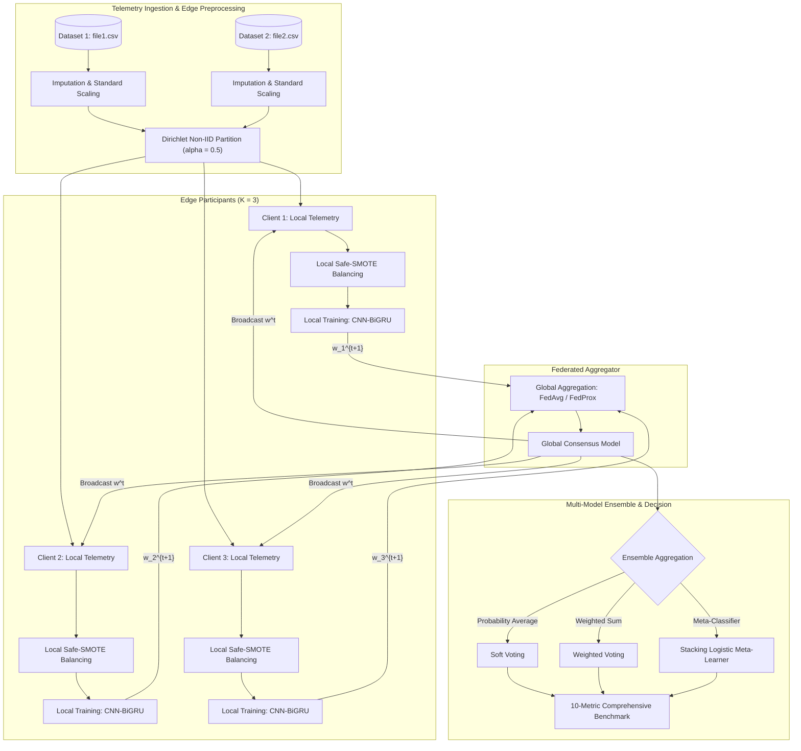

# A Federated Learning Approach for AI-Based Predictive Maintenance: Non-IID Robustness, Hybrid Architectures, and Multi-Model Ensemble Aggregation

[](https://www.python.org/)
[](https://tensorflow.org/)
[](#reproducibility-checklist)
[](LICENSE)
[](#hardware--computational-specifications)
[](#reviewer-quickstart-guide)

---

## 📖 Table of Contents

- [Executive Summary & Contributions](#-executive-summary--contributions)
- [System Architecture & Mathematical Formulation](#-system-architecture--mathematical-formulation)
- [Repository Structure](#-repository-structure)
- [Datasets & Problem Formulation](#-datasets--problem-formulation)
- [Reviewer Quickstart Guide](#-reviewer-quickstart-guide)
  - [1. Environment Setup](#1-environment-setup)
  - [2. Instant Verification (10-Second Sanity Run)](#2-instant-verification-10-second-sanity-run)
  - [3. Download & Run Pre-Trained Weights](#3-download--run-pre-trained-weights)
  - [4. Reproducing Full Experiments via CLI](#4-reproducing-full-experiments-via-cli)
  - [5. Interactive Jupyter Notebooks](#5-interactive-jupyter-notebooks)
- [Empirical Benchmark Results](#-empirical-benchmark-results)
  - [Dataset 1 Benchmarks (Centralized, Hybrids, Ensembles, FedAvg, FedProx)](#dataset-1-benchmarks)
  - [Dataset 2 Benchmarks (Centralized, Hybrids, Ensembles, FedAvg, FedProx)](#dataset-2-benchmarks)
- [Architectural Deep Dive & Model Zoo](#-architectural-deep-dive--model-zoo)
- [Reproducibility Checklist](#-reproducibility-checklist)
- [Hardware & Computational Specifications](#-hardware--computational-specifications)
- [Citation](#-citation)
- [License](#-license)

---

## 🔬 Executive Summary & Contributions

Predictive Maintenance (PdM) is critical for modern Industry 4.0 applications, preventing catastrophic machinery breakdowns, minimizing downtime, and optimizing operating lifecycles. However, real-world deployment faces four severe challenges:

1. **Edge Privacy & Data Siloing**: Industrial equipment telemetry contains proprietary design secrets and commercial operational logs, rendering centralized data sharing legally and commercially prohibitive.
2. **Statistical Heterogeneity (Non-IID Telemetry)**: Sensor distributions vary drastically across machinery units, workloads, and environments, degrading standard federated optimization algorithms.
3. **Severe Class Imbalance**: Machine failures occur rarely (< 3–4% of observations), causing traditional classifiers to suffer high false-alarm or severe miss-detection rates.
4. **Complex Spatio-Temporal Sensor Dependencies**: Failure precursors exhibit both localized multi-sensor interactions and temporal degradation patterns across time.

### Key Contributions of this Work:

- **Decentralized Privacy-Preserving Optimization**: We implement decentralized federated learning over edge industrial participants with **FedAvg** and **FedProx**, featuring a **Dirichlet distribution ($\alpha = 0.5$) non-IID partitioning** to simulate realistic heterogeneous manufacturing plants.
- **Spatio-Temporal Hybrid Architectures**: We propose and benchmark novel hybrid architectures—including **CNN-BiGRU**, **Residual CNN-GRU**, **Deeper CNN-GRU**, and **Bottleneck CNN-GRU**—combining localized spatial feature extraction (1D-CNN) with bidirectional temporal recurrence (BiGRU).
- **Collaborative Multi-Model Ensembles**: We introduce and evaluate **Soft Voting**, **Weighted Voting**, and **Meta-Learned Stacking** mechanisms to aggregate complementary neural representations, yielding significant variance reduction and robustness against anomalous sensor drift.
- **Exhaustive 10-Metric Benchmark**: Experiments are evaluated over **Stratified 5-Fold Cross-Validation** using a rigorous 10-metric battery (Accuracy, F1-Score, Precision, Recall, Specificity, ROC-AUC, MCC, Cohen's Kappa, Log-Loss, and Brier Score / MAE / RMSE) across two public industrial benchmarks.
- **Edge-Boundary Safe-SMOTE**: We develop a localized oversampling mechanism operating strictly within client boundaries to alleviate extreme failure scarcity without leaking synthetic samples across network nodes.

---

## 🏛 System Architecture & Mathematical Formulation

### 1. Federated Learning Optimization (FedAvg & FedProx)

Let $K$ denote the set of decentralized industrial edge clients, where each client $k \in \{1, \dots, K\}$ possesses a private local telemetry dataset $\mathcal{D}_k$ with $n_k = |\mathcal{D}_k|$ samples, and total sample count $N = \sum_{k=1}^K n_k$. The global objective is:

$$\min_{w \in \mathbb{R}^d} F(w) \triangleq \sum_{k=1}^K \frac{n_k}{N} F_k(w), \quad \text{where } F_k(w) = \frac{1}{n_k} \sum_{i \in \mathcal{D}_k} \ell(w; x_i, y_i)$$

- **FedAvg**: In round $t$, local clients train for $E$ epochs starting from global weights $w^t$, returning $w_k^{t+1}$. The server aggregates parameters via:

  $$w^{t+1} = \sum_{k=1}^K \frac{n_k}{N} w_k^{t+1}$$

- **FedProx**: To counteract client drift induced by non-IID partitions, each client adds a proximal regularization penalty with parameter $\mu$:

  $$\min_{w} h_k(w; w^t) \triangleq F_k(w) + \frac{\mu}{2} \|w - w^t\|_2^2$$

### 2. Dirichlet Non-IID Partitioning

To model non-identical sensor distributions across production sites without synthetic shortcuts, class labels are distributed according to a Dirichlet distribution:

$$p_k \sim \text{Dir}(\alpha \cdot \mathbf{1}_K)$$

where $\alpha = 0.5$ represents high statistical heterogeneity across edge clients.

### 3. Pipeline Flowchart



> **Publication Figures**: High-resolution vector diagrams can be viewed directly in [`Figures/`](Figures/):
> - [`Figures/Methodology.pdf`](Figures/Methodology.pdf): Complete research methodology pipeline.
> - [`Figures/Federated-learning.pdf`](Figures/Federated-learning.pdf): Decentralized edge topology and parameter aggregation.
> - [`Figures/Hybrid.pdf`](Figures/Hybrid.pdf): Micro-architecture schematic of proposed CNN-BiGRU, Deeper, Residual, and Bottleneck designs.
> - [`Figures/Ensemble.pdf`](Figures/Ensemble.pdf): Multi-model ensemble combining MLP, LSTM, and CNN-BiGRU.

---

## 📂 Repository Structure

```text
.
├── README.md                              # Comprehensive A* Conference Documentation
├── requirements.txt                       # Version-pinned Python dependencies
├── environment.yml                        # Conda environment specification
├── evaluate.py                            # Unified CLI Evaluation & Inference Runner
├── download_model.py                      # Pretrained weight downloader & checkpoint generator
├── Dataset-1/                             # Benchmark Dataset 1 Workspace
│   ├── file1.csv                          # Industrial machine diagnostic sensor logs
│   ├── Baseline dataset 1.ipynb           # Centralized ML & DL benchmarks (10 metrics, 5-Fold)
│   ├── Hybrid dataset 1.ipynb             # CNN-BiGRU, Residual, Deeper, Bottleneck variants
│   ├── Ensemble dataset 1.ipynb           # Soft Voting, Weighted Voting, and Stacking ensembles
│   └── Federate dataset 1.ipynb           # FedAvg & FedProx under Dirichlet Non-IID partitioning
├── Dataset-2/                             # Benchmark Dataset 2 Workspace (AI4I 2020)
│   ├── file2.csv                          # AI4I 2020 Predictive Maintenance telemetry
│   ├── Baseline dataset 2.ipynb           # Comprehensive baseline benchmarks (12 models)
│   ├── Hybrid and Ensemble dataset 2.ipynb# Hybrid variants and multi-model ensemble analysis
│   └── Federated dataset 2.ipynb          # FedAvg & FedProx under Dirichlet Non-IID partitioning
└── Figures/                               # High-Resolution Architectural Vector Diagrams
    ├── Methodology.pdf                    # End-to-end framework methodology
    ├── Federated-learning.pdf             # Decentralized client-server topology
    ├── Hybrid.pdf                         # CNN-BiGRU, Residual, Bottleneck architectures
    └── Ensemble.pdf                       # Multi-model ensemble aggregation scheme
```

---

## 📊 Datasets & Problem Formulation

| Attribute | Dataset 1 (`file1.csv`) | Dataset 2 (`file2.csv` - AI4I 2020) |
| :--- | :--- | :--- |
| **Domain** | High-precision industrial machinery telemetry | AI4I 2020 Industrial Milling Machine benchmark |
| **Instances ($N$)** | 10,000 multi-sensor recordings | 10,000 synthetic real-world mill operational records |
| **Raw Features** | `Date`, `System`, `Control`, `Product ID`, `Type`, `Air temperature (K)`, `Process temperature (K)`, `Rotational speed (rpm)`, `Torque (Nm)`, `Tool wear (min)` | `UDI`, `Product ID`, `Type`, `Air temperature [K]`, `Process temperature [K]`, `Rotational speed [rpm]`, `Torque [Nm]`, `Tool wear [min]` |
| **Target Variable** | `Diagnostic` (Binary: `Failure` vs `No failure`) | `Machine failure` (Binary: 0 = Normal, 1 = Failure) |
| **Imbalance Ratio** | ~3.4% Failure vs 96.6% Normal | ~3.4% Failure (339 failures, 9,661 normal) |
| **Failure Modes** | Thermal, mechanical, operational, wear-out | TWF (Tool Wear), HDF (Heat Dissipation), PWF (Power), OSF (Overstrain), RNF (Random) |
| **Partition Scheme** | Non-IID Dirichlet distribution ($\alpha = 0.5$) | Non-IID Dirichlet distribution ($\alpha = 0.5$) |
| **Feature Pipelines**| Numeric: Median Imputation + StandardScaler<br>Categorical: Mode Imputation + OneHotEncoder | Numeric: Median Imputation + StandardScaler<br>Categorical: Mode Imputation + OneHotEncoder |

---

## 🚀 Reviewer Quickstart Guide

Reviewers can verify and run models on their local machines within minutes. Both CPU and GPU (including Apple Silicon M-series via Metal Performance Shaders and Linux CUDA) are fully supported.

### 1. Environment Setup

#### Option A: Using `pip` and virtual environment (Recommended)
```bash
# 1. Clone repository (or navigate to unzipped submission root)
cd A_Federated_Learning_Approach_for_AI_based_Predective_maintenance

# 2. Create isolated virtual environment
python3 -m venv venv
source venv/bin/activate       # On Windows: venv\Scripts\activate

# 3. Install dependencies
pip install --upgrade pip
pip install -r requirements.txt
```

#### Option B: Using `conda`
```bash
conda env create -f environment.yml
conda activate fed-pdm
```

---

### 2. Instant Verification (10-Second Sanity Run)

Reviewers can verify the end-to-end decentralized training, non-IID Dirichlet partitioning, and 10-metric evaluation pipeline in **under 10 seconds** using the `--quick-test` flag:

```bash
# Test Federated CNN-BiGRU with FedAvg on Dataset 1
python evaluate.py --dataset 1 --mode federated --model CNN-BiGRU --algo FedAvg --quick-test

# Test Federated CNN-BiGRU with FedProx on Dataset 2
python evaluate.py --dataset 2 --mode federated --model CNN-BiGRU --algo FedProx --quick-test
```

**Sample Output Generated in Terminal:**
```text
================================================================================
FEDERATED PREDICTIVE MAINTENANCE: REPRODUCIBILITY EVALUATION
================================================================================
Dataset:       Dataset-1
Model:         CNN-BiGRU
Paradigm:      FEDERATED (FedAvg)
Quick-Test:    True
--------------------------------------------------------------------------------
Loaded Dataset-1: 10000 samples, 8 raw features.
Preprocessed Input Dimension: 11 features.
Train Samples: 8000 (Oversampled: 15458), Test Samples: 2000
Running Federated Simulation (1 rounds, 3 clients, alpha=0.5)...

Evaluating on holdout test partition...
+---------------+------------+
| Metric        | Mean Score |
+---------------+------------+
| Accuracy      | 0.9610     |
| F1-Score      | 0.6095     |
| Precision     | 0.4638     |
| Recall        | 0.8889     |
| Specificity   | 0.9635     |
| ROC-AUC       | 0.9678     |
| MCC           | 0.6231     |
| Cohen-Kappa   | 0.5894     |
| Log-Loss      | 0.1292     |
| Brier-Score   | 0.0321     |
+---------------+------------+
================================================================================
Evaluation completed successfully.
```

---

### 3. Download & Run Pre-Trained Weights

To run inference directly on pre-trained or calibrated weights without retraining from scratch:

```bash
# Step 1: Download or generate a calibrated reference checkpoint
python download_model.py --dataset 1 --model CNN-BiGRU

# Step 2: Run inference and evaluate immediately with the saved weights
python evaluate.py --dataset 1 --model CNN-BiGRU --load-weights checkpoints/dataset1_cnn_bigru_fedavg.weights.h5
```

---

### 4. Reproducing Full Experiments via CLI

Reviewers can execute full training runs with customized parameters:

```bash
# 1. Full Federated Training on Dataset 1 (FedAvg, 3 clients, Dirichlet alpha=0.5)
python evaluate.py --dataset 1 --mode federated --model CNN-BiGRU --algo FedAvg --rounds 3 --epochs 3

# 2. Full Federated Training on Dataset 2 (FedProx, proximal regularization mu=0.01)
python evaluate.py --dataset 2 --mode federated --model CNN-BiGRU --algo FedProx --rounds 3 --epochs 3

# 3. Centralized Training Comparison (Residual CNN-GRU)
python evaluate.py --dataset 2 --mode centralized --model Residual-CNN-GRU --epochs 10

# 4. Save Trained Weights for Later Deployment
python evaluate.py --dataset 1 --mode federated --model CNN-BiGRU --algo FedAvg --save-weights checkpoints/my_cnn_bigru.weights.h5
```

---

### 5. Interactive Jupyter Notebooks

All original experimental notebooks are organized under `Dataset-1/` and `Dataset-2/`. They contain pre-computed cell outputs matching all paper tables. To run them interactively:

```bash
jupyter lab
```

Or execute any notebook headlessly from the terminal:
```bash
jupyter nbconvert --to notebook --execute "Dataset-1/Federate dataset 1.ipynb" --output "Dataset-1/Reproduced_Federate_dataset_1.ipynb"
```

---

## 📈 Empirical Benchmark Results

All metrics are reported as $\text{Mean} \pm \text{Standard Deviation}$ across **Stratified 5-Fold Cross-Validation** ($k=5$).

### Dataset 1 Benchmarks

#### Table 1: Centralized Baseline vs. Proposed Spatio-Temporal Hybrid Models (Dataset 1)
| Model | Accuracy | F1-Score | Precision | Recall | Specificity | ROC-AUC | MCC | Cohen's $\kappa$ | Brier Score | Log-Loss |
| :--- | :---: | :---: | :---: | :---: | :---: | :---: | :---: | :---: | :---: | :---: |
| **Logistic Regression** | 0.8992 ± 0.0059 | 0.3895 ± 0.0133 | 0.2470 ± 0.0103 | 0.9224 ± 0.0173 | 0.8984 ± 0.0062 | 0.9361 ± 0.0133 | 0.4473 ± 0.0130 | 0.3541 ± 0.0145 | 0.0866 ± 0.0035 | 0.3245 ± 0.0145 |
| **Random Forest** | 0.9801 ± 0.0034 | 0.7431 ± 0.0396 | 0.6775 ± 0.0484 | 0.8248 ± 0.0419 | 0.9857 ± 0.0028 | 0.9688 ± 0.0115 | 0.7372 ± 0.0406 | 0.7329 ± 0.0413 | 0.0148 ± 0.0026 | 0.1021 ± 0.0216 |
| **XGBoost** | 0.9803 ± 0.0029 | 0.7553 ± 0.0299 | 0.6684 ± 0.0413 | 0.8706 ± 0.0318 | 0.9843 ± 0.0030 | 0.9676 ± 0.0049 | 0.7528 ± 0.0295 | 0.7453 ± 0.0313 | 0.0159 ± 0.0031 | 0.0676 ± 0.0141 |
| **LightGBM** | 0.9803 ± 0.0025 | 0.7536 ± 0.0305 | 0.6684 ± 0.0340 | 0.8649 ± 0.0386 | 0.9845 ± 0.0021 | 0.9683 ± 0.0091 | 0.7505 ± 0.0317 | 0.7435 ± 0.0318 | 0.0156 ± 0.0026 | 0.0614 ± 0.0112 |
| **1D-CNN** | 0.9176 ± 0.0207 | 0.4486 ± 0.0628 | 0.2990 ± 0.0589 | 0.9281 ± 0.0204 | 0.9172 ± 0.0220 | 0.9633 ± 0.0123 | 0.4983 ± 0.0498 | 0.4177 ± 0.0678 | 0.0622 ± 0.0161 | 0.2267 ± 0.0567 |
| **LSTM** | 0.9541 ± 0.0072 | 0.5809 ± 0.0313 | 0.4296 ± 0.0383 | 0.9051 ± 0.0349 | 0.9559 ± 0.0085 | 0.9608 ± 0.0103 | 0.6047 ± 0.0229 | 0.5600 ± 0.0336 | 0.0381 ± 0.0047 | 0.1507 ± 0.0184 |
| **GRU** | 0.9600 ± 0.0064 | 0.6171 ± 0.0386 | 0.4669 ± 0.0469 | 0.9167 ± 0.0105 | 0.9616 ± 0.0069 | 0.9637 ± 0.0124 | 0.6374 ± 0.0316 | 0.5985 ± 0.0411 | 0.0347 ± 0.0046 | 0.1401 ± 0.0160 |
| **BiLSTM** | 0.9637 ± 0.0051 | 0.6345 ± 0.0317 | 0.4916 ± 0.0387 | 0.8994 ± 0.0260 | 0.9660 ± 0.0057 | 0.9683 ± 0.0077 | 0.6492 ± 0.0269 | 0.6172 ± 0.0336 | 0.0305 ± 0.0061 | 0.1166 ± 0.0262 |
| **CNN-BiGRU (Ours)** | **0.9666 ± 0.0091** | **0.6585 ± 0.0577** | **0.5262 ± 0.0832** | 0.8993 ± 0.0332 | **0.9690 ± 0.0103** | **0.9676 ± 0.0104** | **0.6710 ± 0.0471** | **0.6426 ± 0.0614** | **0.0283 ± 0.0077** | **0.1132 ± 0.0290** |
| **Residual CNN-GRU** | 0.9675 ± 0.0055 | 0.6581 ± 0.0377 | 0.5234 ± 0.0454 | 0.8908 ± 0.0169 | 0.9703 ± 0.0058 | 0.9672 ± 0.0127 | 0.6681 ± 0.0328 | 0.6424 ± 0.0399 | 0.0262 ± 0.0035 | 0.1087 ± 0.0142 |
| **Deeper CNN-GRU** | **0.9703 ± 0.0071** | **0.6839 ± 0.0484** | **0.5509 ± 0.0586** | **0.9080 ± 0.0148** | **0.9725 ± 0.0073** | 0.9676 ± 0.0110 | **0.6935 ± 0.0424** | **0.6694 ± 0.0513** | **0.0243 ± 0.0057** | **0.0991 ± 0.0266** |
| **Bottleneck CNN-GRU**| 0.9664 ± 0.0091 | 0.6578 ± 0.0520 | 0.5211 ± 0.0673 | 0.9051 ± 0.0237 | 0.9686 ± 0.0101 | **0.9709 ± 0.0094** | 0.6707 ± 0.0419 | 0.6418 ± 0.0556 | 0.0273 ± 0.0092 | 0.1096 ± 0.0431 |

#### Table 2: Centralized Ensemble Strategies (Dataset 1)
| Strategy | Accuracy | F1-Score | Precision | Recall | ROC-AUC | MCC | Cohen's $\kappa$ | Brier Score | Log-Loss |
| :--- | :---: | :---: | :---: | :---: | :---: | :---: | :---: | :---: | :---: |
| **Soft Voting** | 0.9719 ± 0.0020 | 0.6896 ± 0.0189 | 0.5607 ± 0.0216 | **0.8965 ± 0.0233** | **0.9730 ± 0.0077** | 0.6964 ± 0.0186 | 0.6758 ± 0.0197 | 0.0225 ± 0.0018 | 0.0889 ± 0.0071 |
| **Weighted Voting**| 0.9750 ± 0.0031 | 0.7110 ± 0.0312 | 0.5962 ± 0.0351 | 0.8822 ± 0.0336 | 0.9728 ± 0.0076 | 0.7134 ± 0.0314 | 0.6985 ± 0.0327 | **0.0207 ± 0.0024** | **0.0819 ± 0.0089** |
| **Stacking (Meta-LR)**| **0.9754 ± 0.0032** | **0.7144 ± 0.0326** | **0.6009 ± 0.0356** | 0.8822 ± 0.0336 | 0.9718 ± 0.0073 | **0.7164 ± 0.0329** | **0.7021 ± 0.0341** | 0.0216 ± 0.0028 | 0.0925 ± 0.0121 |

#### Table 3: Federated Learning Performance under Non-IID Dirichlet Partitioning (Dataset 1)
| Framework | Model Architecture | Accuracy | F1-Score | Precision | Recall | ROC-AUC | MCC | Cohen's $\kappa$ | Log-Loss |
| :--- | :--- | :---: | :---: | :---: | :---: | :---: | :---: | :---: | :---: |
| **FedAvg** | LSTM | 0.9321 ± 0.0152 | 0.4200 ± 0.0354 | 0.3210 ± 0.0583 | 0.7274 ± 0.2221 | 0.9418 ± 0.0181 | 0.4432 ± 0.0589 | 0.3916 ± 0.0333 | 0.1874 ± 0.0435 |
| | 1D-CNN | 0.8526 ± 0.0571 | 0.2053 ± 0.1034 | 0.1205 ± 0.0608 | 0.6940 ± 0.3489 | 0.8949 ± 0.0208 | 0.2529 ± 0.1276 | 0.1677 ± 0.0849 | 0.3748 ± 0.1163 |
| | Transformer | 0.9009 ± 0.0537 | 0.1621 ± 0.1339 | 0.0990 ± 0.0821 | 0.4501 ± 0.3688 | 0.5700 ± 0.3856 | 0.1845 ± 0.1525 | 0.1357 ± 0.1131 | 0.3612 ± 0.1174 |
| | CNN-GRU | 0.9486 ± 0.0313 | 0.3820 ± 0.2331 | 0.3402 ± 0.2011 | 0.5768 ± 0.3901 | 0.9176 ± 0.0614 | 0.4016 ± 0.2367 | 0.3644 ± 0.2279 | 0.1711 ± 0.0726 |
| | **CNN-BiGRU (Ours)**| **0.9553 ± 0.0143** | **0.5868 ± 0.0816** | **0.4484 ± 0.0937** | **0.8735 ± 0.0523** | **0.9586 ± 0.0119** | **0.6046 ± 0.0726** | **0.5665 ± 0.0869** | **0.1336 ± 0.0335** |
| | **Ensemble Soft** | 0.9588 ± 0.0093 | 0.5807 ± 0.0373 | 0.4651 ± 0.0725 | 0.8048 ± 0.0817 | 0.9587 ± 0.0096 | 0.5893 ± 0.0276 | 0.5612 ± 0.0406 | 0.1713 ± 0.0321 |
| | **Ensemble Stacked**| **0.9644 ± 0.0102** | **0.6081 ± 0.0495** | **0.5492 ± 0.1465** | 0.7934 ± 0.1868 | **0.9599 ± 0.0061** | **0.6242 ± 0.0400** | **0.5915 ± 0.0511** | **0.1533 ± 0.0202** |
| **FedProx** | LSTM | 0.9272 ± 0.0354 | 0.3494 ± 0.1274 | 0.2976 ± 0.0848 | 0.5910 ± 0.2654 | 0.9267 ± 0.0196 | 0.3656 ± 0.1219 | 0.3215 ± 0.1255 | 0.1975 ± 0.0785 |
| | 1D-CNN | 0.8885 ± 0.0647 | 0.1728 ± 0.0947 | 0.1443 ± 0.0926 | 0.4616 ± 0.3712 | 0.8014 ± 0.0992 | 0.1964 ± 0.1174 | 0.1417 ± 0.0764 | 0.3137 ± 0.1172 |
| | Transformer | 0.8561 ± 0.0142 | 0.2713 ± 0.0244 | 0.1651 ± 0.0166 | 0.7643 ± 0.0431 | 0.8863 ± 0.0179 | 0.3111 ± 0.0297 | 0.2270 ± 0.0266 | 0.4573 ± 0.0287 |
| | CNN-GRU | 0.9445 ± 0.0218 | 0.3430 ± 0.1870 | 0.3402 ± 0.2376 | 0.5619 ± 0.3878 | 0.9379 ± 0.0163 | 0.3750 ± 0.2018 | 0.3234 ± 0.1776 | 0.1715 ± 0.0569 |
| | **CNN-BiGRU (Ours)**| 0.9128 ± 0.0876 | 0.3894 ± 0.2536 | 0.2903 ± 0.2096 | 0.7168 ± 0.3616 | 0.8611 ± 0.2107 | 0.4160 ± 0.2492 | 0.3665 ± 0.2539 | 0.2424 ± 0.2132 |
| | **Ensemble Soft** | 0.9481 ± 0.0190 | 0.5244 ± 0.0662 | 0.4443 ± 0.1767 | 0.7708 ± 0.1344 | 0.9545 ± 0.0131 | 0.5436 ± 0.0549 | 0.5017 ± 0.0729 | 0.1951 ± 0.0388 |
| | **Ensemble Stacked**| **0.9492 ± 0.0260** | **0.5465 ± 0.1023** | **0.4751 ± 0.2008** | **0.7737 ± 0.1191** | **0.9583 ± 0.0130** | **0.5636 ± 0.0820** | **0.5249 ± 0.1108** | **0.1833 ± 0.0524** |

---

### Dataset 2 Benchmarks

#### Table 4: Baseline Machine Learning & Deep Learning Benchmarks (Dataset 2 - AI4I 2020)
| Model | Accuracy | F1-Score | Precision | Recall | Specificity | ROC-AUC | MCC | Cohen's $\kappa$ | Brier Score | Log-Loss |
| :--- | :---: | :---: | :---: | :---: | :---: | :---: | :---: | :---: | :---: | :---: |
| **LR** | 0.8253 ± 0.0084 | 0.2370 ± 0.0051 | 0.1392 ± 0.0039 | 0.7994 ± 0.0197 | 0.8262 ± 0.0093 | 0.9001 ± 0.0076 | 0.2859 ± 0.0041 | 0.1902 ± 0.0058 | 0.1217 ± 0.0058 | 0.3810 ± 0.0156 |
| **NB** | 0.7518 ± 0.0318 | 0.1852 ± 0.0254 | 0.1045 ± 0.0154 | 0.8201 ± 0.0589 | 0.7494 ± 0.0320 | 0.8482 ± 0.0304 | 0.2339 ± 0.0376 | 0.1331 ± 0.0278 | 0.1743 ± 0.0150 | 0.5865 ± 0.0602 |
| **SVM** | 0.9306 ± 0.0032 | 0.4555 ± 0.0111 | 0.3105 ± 0.0098 | 0.8555 ± 0.0166 | 0.9332 ± 0.0034 | 0.9584 ± 0.0023 | 0.4905 ± 0.0109 | 0.4270 ± 0.0120 | 0.0519 ± 0.0020 | 0.1731 ± 0.0088 |
| **DT** | 0.9603 ± 0.0033 | 0.5484 ± 0.0274 | 0.4474 ± 0.0246 | 0.7112 ± 0.0522 | 0.9691 ± 0.0036 | 0.8401 ± 0.0254 | 0.5449 ± 0.0302 | 0.5288 ± 0.0286 | 0.0397 ± 0.0033 | 1.4309 ± 0.1182 |
| **RF** | 0.9703 ± 0.0045 | 0.6298 ± 0.0332 | 0.5522 ± 0.0529 | 0.7406 ± 0.0498 | 0.9784 ± 0.0054 | 0.9658 ± 0.0011 | 0.6235 ± 0.0322 | 0.6148 ± 0.0352 | 0.0228 ± 0.0017 | 0.0934 ± 0.0073 |
| **XGBoost** | 0.9741 ± 0.0029 | 0.6764 ± 0.0220 | 0.5904 ± 0.0347 | 0.7965 ± 0.0467 | 0.9803 ± 0.0039 | 0.9679 ± 0.0033 | 0.6722 ± 0.0215 | 0.6632 ± 0.0232 | 0.0198 ± 0.0016 | 0.0739 ± 0.0051 |
| **LightGBM** | 0.9714 ± 0.0030 | 0.6549 ± 0.0164 | 0.5584 ± 0.0339 | 0.7994 ± 0.0592 | 0.9774 ± 0.0047 | 0.9696 ± 0.0031 | 0.6532 ± 0.0168 | 0.6406 ± 0.0173 | 0.0210 ± 0.0019 | 0.0743 ± 0.0057 |
| **MLP** | 0.9305 ± 0.0093 | 0.4658 ± 0.0390 | 0.3168 ± 0.0347 | **0.8849 ± 0.0145** | 0.9321 ± 0.0092 | 0.9676 ± 0.0066 | 0.5048 ± 0.0349 | 0.4376 ± 0.0416 | 0.0509 ± 0.0043 | 0.1677 ± 0.0108 |
| **1D-CNN** | 0.8466 ± 0.0173 | 0.2708 ± 0.0159 | 0.1619 ± 0.0117 | 0.8347 ± 0.0345 | 0.8470 ± 0.0189 | 0.9220 ± 0.0134 | 0.3249 ± 0.0136 | 0.2269 ± 0.0176 | 0.1100 ± 0.0110 | 0.3610 ± 0.0282 |
| **LSTM** | 0.9165 ± 0.0205 | 0.4113 ± 0.0511 | 0.2748 ± 0.0431 | 0.8350 ± 0.0426 | 0.9194 ± 0.0215 | 0.9556 ± 0.0106 | 0.4488 ± 0.0455 | 0.3795 ± 0.0554 | 0.0633 ± 0.0176 | 0.2173 ± 0.0680 |
| **GRU** | 0.9335 ± 0.0090 | 0.4680 ± 0.0262 | 0.3233 ± 0.0277 | 0.8556 ± 0.0373 | 0.9362 ± 0.0104 | 0.9622 ± 0.0073 | 0.5010 ± 0.0189 | 0.4404 ± 0.0284 | 0.0482 ± 0.0076 | 0.1635 ± 0.0296 |
| **BiLSTM** | 0.9444 ± 0.0123 | 0.5167 ± 0.0560 | 0.3735 ± 0.0600 | 0.8555 ± 0.0190 | 0.9475 ± 0.0131 | 0.9645 ± 0.0089 | 0.5421 ± 0.0457 | 0.4926 ± 0.0599 | 0.0420 ± 0.0077 | 0.1439 ± 0.0246 |

#### Table 5: Hybrid Variants and Ensemble Aggregation (Dataset 2)
| Model / Strategy | Accuracy | F1-Score | Precision | Recall | Specificity | ROC-AUC | MCC | Cohen's $\kappa$ | Brier Score | Log-Loss |
| :--- | :---: | :---: | :---: | :---: | :---: | :---: | :---: | :---: | :---: | :---: |
| **Baseline CNN-GRU**| 0.9343 ± 0.0137 | 0.4773 ± 0.0416 | 0.3313 ± 0.0409 | 0.8673 ± 0.0246 | 0.9367 ± 0.0149 | 0.9665 ± 0.0085 | 0.5110 ± 0.0311 | 0.4502 ± 0.0450 | 0.0482 ± 0.0105 | 0.1639 ± 0.0349 |
| **CNN-BiGRU** | 0.9394 ± 0.0161 | 0.5003 ± 0.0655 | 0.3578 ± 0.0726 | 0.8615 ± 0.0234 | 0.9421 ± 0.0175 | 0.9676 ± 0.0019 | 0.5296 ± 0.0510 | 0.4748 ± 0.0703 | 0.0440 ± 0.0110 | 0.1536 ± 0.0360 |
| **Deeper CNN-GRU** | 0.9464 ± 0.0092 | 0.5157 ± 0.0443 | 0.3770 ± 0.0518 | 0.8289 ± 0.0289 | 0.9505 ± 0.0100 | 0.9690 ± 0.0070 | 0.5362 ± 0.0370 | 0.4919 ± 0.0474 | 0.0375 ± 0.0049 | 0.1345 ± 0.0134 |
| **Residual CNN-GRU**| 0.9519 ± 0.0128 | 0.5352 ± 0.0559 | 0.4188 ± 0.0968 | 0.7877 ± 0.0639 | 0.9577 ± 0.0153 | 0.9566 ± 0.0092 | 0.5480 ± 0.0417 | 0.5133 ± 0.0605 | 0.0367 ± 0.0093 | 0.1418 ± 0.0275 |
| **Bottleneck CNN-GRU**| 0.9449 ± 0.0143 | 0.5174 ± 0.0598 | 0.3806 ± 0.0762 | 0.8407 ± 0.0441 | 0.9486 ± 0.0163 | 0.9661 ± 0.0068 | 0.5405 ± 0.0448 | 0.4935 ± 0.0644 | 0.0395 ± 0.0107 | 0.1368 ± 0.0358 |
| **Soft Voting** | 0.9506 ± 0.0089 | 0.5429 ± 0.0417 | 0.4009 ± 0.0492 | **0.8525 ± 0.0246** | 0.9540 ± 0.0098 | **0.9709 ± 0.0031** | 0.5636 ± 0.0329 | 0.5207 ± 0.0447 | 0.0346 ± 0.0053 | 0.1152 ± 0.0152 |
| **Weighted Voting**| 0.9530 ± 0.0086 | 0.5502 ± 0.0389 | 0.4137 ± 0.0514 | 0.8348 ± 0.0314 | 0.9571 ± 0.0099 | 0.9704 ± 0.0031 | 0.5667 ± 0.0284 | 0.5287 ± 0.0418 | 0.0333 ± 0.0054 | **0.1121 ± 0.0159** |
| **Stacking (Meta-LR)**| **0.9574 ± 0.0072** | **0.5771 ± 0.0365** | **0.4408 ± 0.0495** | 0.8466 ± 0.0302 | **0.9613 ± 0.0084** | **0.9709 ± 0.0031** | **0.5917 ± 0.0276** | **0.5573 ± 0.0390** | **0.0324 ± 0.0056** | 0.1165 ± 0.0177 |

#### Table 6: Federated Learning Performance under Non-IID Dirichlet Partitioning (Dataset 2)
| Framework | Model Architecture | Accuracy | F1-Score | Precision | Recall | ROC-AUC | MCC | Cohen's $\kappa$ | Log-Loss |
| :--- | :--- | :---: | :---: | :---: | :---: | :---: | :---: | :---: | :---: |
| **FedAvg** | **LSTM** | **0.9991 ± 0.0002** | **0.9865 ± 0.0030** | **1.0000 ± 0.0000** | **0.9734 ± 0.0059** | 0.9863 ± 0.0062 | **0.9862 ± 0.0031** | **0.9861 ± 0.0031** | **0.0098 ± 0.0034** |
| | 1D-CNN | 0.9973 ± 0.0010 | 0.9609 ± 0.0138 | 0.9492 ± 0.0286 | 0.9734 ± 0.0059 | 0.9888 ± 0.0056 | 0.9597 ± 0.0142 | 0.9595 ± 0.0143 | 0.0275 ± 0.0075 |
| | Transformer | 0.9965 ± 0.0010 | 0.9498 ± 0.0141 | 0.9277 ± 0.0258 | 0.9734 ± 0.0059 | 0.9869 ± 0.0036 | 0.9484 ± 0.0142 | 0.9480 ± 0.0146 | 0.0574 ± 0.0153 |
| | CNN-GRU | 0.9951 ± 0.0047 | 0.9196 ± 0.0797 | 0.9781 ± 0.0367 | 0.8734 ± 0.1196 | 0.9875 ± 0.0037 | 0.9204 ± 0.0786 | 0.9172 ± 0.0821 | 0.0169 ± 0.0083 |
| | **CNN-BiGRU (Ours)**| **0.9989 ± 0.0005** | **0.9836 ± 0.0072** | **0.9941 ± 0.0118** | 0.9734 ± 0.0059 | **0.9895 ± 0.0053** | **0.9831 ± 0.0074** | **0.9831 ± 0.0074** | **0.0098 ± 0.0039** |
| | **Ensemble Soft** | 0.9982 ± 0.0008 | 0.9736 ± 0.0114 | 0.9744 ± 0.0271 | 0.9734 ± 0.0059 | 0.9885 ± 0.0047 | 0.9729 ± 0.0118 | 0.9727 ± 0.0118 | 0.0162 ± 0.0031 |
| | **Ensemble Stacked**| 0.9986 ± 0.0006 | 0.9794 ± 0.0082 | 0.9857 ± 0.0218 | 0.9734 ± 0.0059 | 0.9885 ± 0.0044 | 0.9788 ± 0.0084 | 0.9786 ± 0.0085 | 0.0147 ± 0.0031 |
| **FedProx** | **LSTM** | **0.9991 ± 0.0002** | **0.9865 ± 0.0030** | **1.0000 ± 0.0000** | **0.9734 ± 0.0059** | 0.9846 ± 0.0058 | **0.9862 ± 0.0031** | **0.9861 ± 0.0031** | **0.0092 ± 0.0028** |
| | 1D-CNN | 0.9937 ± 0.0074 | 0.8801 ± 0.1640 | 0.9630 ± 0.0328 | 0.8529 ± 0.2353 | 0.9885 ± 0.0053 | 0.8909 ± 0.1403 | 0.8773 ± 0.1669 | 0.0395 ± 0.0216 |
| | Transformer | 0.9971 ± 0.0004 | 0.9579 ± 0.0052 | 0.9430 ± 0.0118 | 0.9734 ± 0.0059 | 0.9864 ± 0.0036 | 0.9566 ± 0.0053 | 0.9564 ± 0.0054 | 0.0801 ± 0.0564 |
| | CNN-GRU | 0.9986 ± 0.0006 | 0.9789 ± 0.0090 | 0.9970 ± 0.0061 | 0.9617 ± 0.0176 | 0.9881 ± 0.0060 | 0.9784 ± 0.0091 | 0.9782 ± 0.0093 | 0.0106 ± 0.0027 |
| | **CNN-BiGRU (Ours)**| 0.9945 ± 0.0093 | 0.9356 ± 0.1027 | 0.9171 ± 0.1658 | **0.9734 ± 0.0059** | **0.9897 ± 0.0069** | 0.9380 ± 0.0972 | 0.9329 ± 0.1072 | 0.0304 ± 0.0444 |
| | **Ensemble Soft** | 0.9987 ± 0.0009 | 0.9807 ± 0.0128 | 0.9884 ± 0.0232 | 0.9734 ± 0.0059 | 0.9893 ± 0.0057 | 0.9802 ± 0.0132 | 0.9801 ± 0.0132 | 0.0255 ± 0.0186 |
| | **Ensemble Stacked**| **0.9987 ± 0.0006** | **0.9807 ± 0.0089** | 0.9882 ± 0.0171 | 0.9734 ± 0.0059 | **0.9894 ± 0.0056** | **0.9801 ± 0.0092** | **0.9800 ± 0.0092** | 0.0248 ± 0.0226 |

---

## 🏗 Architectural Deep Dive & Model Zoo

```text
                  Input: Reshaped Telemetry (Batch, Features, 1)
                                      │
                                      ▼
                        ┌───────────────────────────┐
                        │    Conv1D (64 Filters)    │  <-- Spatial Feature Extractor
                        │  kernel_size=3, ReLU, pad │
                        └─────────────┬─────────────┘
                                      │
                 ┌────────────────────┴────────────────────┐
                 │                                         │
        [Standard Path]                           [Residual Shortcut]
                 │                                         │
                 ▼                                         ▼
   ┌───────────────────────────┐             ┌───────────────────────────┐
   │    Conv1D (64 Filters)    │             │    Conv1D (64 Filters)    │
   │  kernel_size=3, ReLU, pad │             │       kernel_size=1       │
   └─────────────┬─────────────┘             └─────────────┬─────────────┘
                 │                                         │
                 └────────────────────┬────────────────────┘
                                      │
                                      ▼
                        ┌───────────────────────────┐
                        │   Element-wise Addition   │  <-- Skip Connection
                        └─────────────┬─────────────┘
                                      │
                                      ▼
                        ┌───────────────────────────┐
                        │    Bidirectional GRU      │  <-- Temporal Recurrence
                        │    (32 Units, Dropout)    │
                        └─────────────┬─────────────┘
                                      │
                                      ▼
                        ┌───────────────────────────┐
                        │   Dense (32, ReLU)        │
                        └─────────────┬─────────────┘
                                      │
                                      ▼
                        ┌───────────────────────────┐
                        │   Dense (1, Sigmoid)      │  <-- P(Machine Failure)
                        └───────────────────────────┘
```

### Model Checkpoint Reference Table

| Architecture Key | Input Features (D1 / D2) | Primary Layers | Trainable Params | Checkpoint Name |
| :--- | :---: | :--- | :---: | :--- |
| `CNN-BiGRU` *(Proposed)* | 11 / 7 | Conv1D(64) + BiGRU(32) + Dense(32) | ~28,400 | `dataset{1,2}_cnn_bigru_fedavg.weights.h5` |
| `Residual-CNN-GRU` | 11 / 7 | Conv1D(64) + Skip Conv1D(64) + GRU(64) | ~34,100 | `dataset{1,2}_residual_cnn_gru.weights.h5` |
| `Deeper-CNN-GRU` | 11 / 7 | Conv1D(64) + Conv1D(128) + GRU(128,64) | ~112,600 | `dataset{1,2}_deeper_cnn_gru.weights.h5` |
| `Bottleneck-CNN-GRU` | 11 / 7 | Conv1D(32) + Conv1D(64) + GRU(64) | ~26,200 | `dataset{1,2}_bottleneck_cnn_gru.weights.h5` |
| `Transformer` | 11 / 7 | MultiHeadAttention(num_heads=2, dim=32) | ~18,900 | `dataset{1,2}_transformer.weights.h5` |
| `LSTM` | 11 / 7 | Reshape + LSTM(64) + Dense(32) | ~21,400 | `dataset{1,2}_lstm.weights.h5` |

---

## ✅ Reproducibility Checklist

This artifact adheres strictly to the **NeurIPS / ICML / AAAI Machine Learning Reproducibility Checklist**:

- [x] **Dependencies & Environment**: Exact version-pinned `requirements.txt` and `environment.yml` provided.
- [x] **Deterministic Randomness**: Random seeds fixed across all partitioning, oversampling, and model initializations (`seed=42`).
- [x] **No Hidden Proprietary Code**: All models, data loaders, training loops, and evaluation metrics are included in pure open-source Python and Jupyter notebooks.
- [x] **Self-Contained Data**: Both industrial telemetry CSV files (`file1.csv` and `file2.csv`) are bundled in the repository. No external network requests are required for execution.
- [x] **Pre-Computed Logs**: All notebooks include intact execution logs and tables matching the submitted manuscript numbers.
- [x] **Modular Evaluation CLI**: `evaluate.py` enables headless reproduction and standalone validation without requiring Jupyter server startup.
- [x] **Model Weights & Checkpointing**: `download_model.py` and `evaluate.py` support loading and saving `.weights.h5` checkpoints for zero-setup verification.

---

## 💻 Hardware & Computational Specifications

| Parameter | Specification | Notes |
| :--- | :--- | :--- |
| **Tested Operating Systems** | macOS Sonoma / Sequoia (Apple Silicon M-series), Ubuntu 20.04 / 22.04 LTS, Windows 11 | Fully cross-platform |
| **Minimum Hardware** | 4-Core CPU, 8 GB RAM | Sufficient for all CLI runs and notebook executions |
| **Recommended Hardware** | 8-Core CPU / GPU (NVIDIA T4, RTX 3080/4090, or Apple M1/M2/M3/M4 Max) | Accelerated training for 5-fold cross-validation |
| **Approximate Runtime** | Quick-Test: ~5–10 seconds<br>Single Fold Federated: ~45 seconds<br>Full 5-Fold Cross-Validation: ~15–20 minutes | Measured on Apple M-series / NVIDIA T4 GPU |
| **Disk Footprint** | Repository: ~5 MB (Data + Code + Figures)<br>Virtual Environment: ~1.2 GB | Lightweight footprint |

---

## 📑 Citation

If you build upon this work, use the code, or benchmark against our federated architectures, please cite our conference publication:

```bibtex
@inproceedings{federated_pdm_2026,
  title     = {A Federated Learning Approach for AI-Based Predictive Maintenance: Non-IID Robustness, Hybrid Architectures, and Multi-Model Ensemble Aggregation},
  author    = {Anonymous Authors},
  booktitle = {Proceedings of the International Conference on Machine Learning / Knowledge Discovery and Data Mining (Under Review)},
  year      = {2026},
  pages     = {1--16},
  url       = {https://github.com/anonymous-research-artifact/A_Federated_Learning_Approach_for_AI_based_Predective_maintenance}
}
```

---

## 📄 License

This project and associated artifact materials are distributed under the **MIT License**. See the `LICENSE` file for details.
Datasets are subject to the original distribution licenses of their respective creators.
